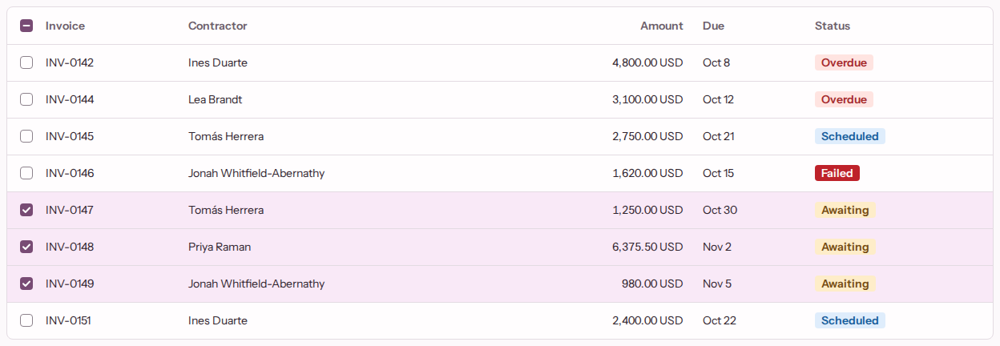

# design-demo

An AI-built design system, and the guardrails that keep AI-generated screens on it.

I'm not a designer. I've spent 15 years making designers' work ship at award level. This repo encodes that craft as a system: a one-page design brief I wrote, a component library Claude Code built against it, and the gates and evals that keep AI output production-ready.

**[Storybook](https://gianko.github.io/design-demo/)** · **[Eval report](https://gianko.github.io/design-demo/evals/)** · **[Figma file](https://www.figma.com/design/qgCHZ55XTiozWpZvASRzJE/Dill-Demo)** · **[Design brief](docs/design-brief.md)**

| A generated screen, kept and gated | A library component at admin density |
|---|---|
|  |  |

## What it is

The domain is contractor payroll and invoicing: an admin who clears dozens of invoices a day, and a contractor who checks on their money a few times a month.

1. **A human-written design brief** is the source of taste: [`docs/design-brief.md`](docs/design-brief.md). It sets tone, density by audience, type, colour roles, spacing, radius, elevation and motion, and bans the generic AI defaults (no Inter, no Tailwind palette, no pills, no bounce easing).
2. **Claude Code builds the design system against it.** DTCG tokens become CSS variables, TypeScript types and Figma variables. Each of the 11 components was built by one headless `/build-component` session that has to pass every gate. A human approves its baselines, and triages what the session wrote up as gaps.
3. **A generator turns a plain-language screen brief into a screen** in two steps: a typed UI spec (Zod-validated JSON that can only name registered components and props), then real React/TSX from that spec. It uses only library components and tokens, never raw elements or values.
4. **Gates pass or fail the output**, and each step repairs itself from the failures, up to 3 attempts.
5. **An eval suite** runs a fixed set of screen briefs K times and reports pass rates, attempts and cost, comparable across prompt and registry versions.
6. **Figma is an output.** Tokens sync into Figma variables with light/dark and admin/contractor modes, and kept screens are captured as layers bound to those variables, through Figma's official MCP server. Code is the source of truth.

## Results: first full eval run

Five screen briefs, K = 3, Opus 5.5, on a clean tree at `ce3d3b5` ([results file](evals/results/2026-10-26-eval.json), [report](https://gianko.github.io/design-demo/evals/)).

| Screen brief | Audience | Passed | First attempt | Cost |
|---|---|---|---|---|
| [invoice-queue](evals/briefs/invoice-queue.md) | admin | 3 / 3 | 3 / 3 | $0.76 |
| [invoice-review](evals/briefs/invoice-review.md) | admin | 3 / 3 | 0 / 3 | $0.92 |
| [payment-overview](evals/briefs/payment-overview.md) | contractor | 3 / 3 | 3 / 3 | $0.76 |
| [payment-run](evals/briefs/payment-run.md) | admin | 3 / 3 | 2 / 3 | $0.79 |
| [payment-status](evals/briefs/payment-status.md) | contractor | 3 / 3 | 2 / 3 | $0.75 |
| **All** | | **15 / 15** | **10 / 15** | **$3.98** |

Every first-attempt failure was the same one: the code step read a fixture binding that is `null` in the empty state, and TypeScript (gate 3) caught it. One repair turn fixed each. It's a prompt fix, and the next run will show whether it worked.

## The gates

Gates run on generated screens and on the design system itself, so the library is held to the standard it enforces. `pnpm gate` renders every story in one pinned Playwright image, light and dark × admin and contractor, locally and in CI.

| Gate | Checks | |
|---|---|---|
| 1 | UI spec: schema, registered components and props only, valid bindings, states and actions | ✅ |
| 2 | ESLint: no raw colour, spacing, radius or font values; library imports only; screen state only through the library | ✅ |
| 3 | TypeScript and build | ✅ |
| 4 | Accessibility: axe-core, serious or critical fails | ✅ |
| 5 | Brief conformance: a rendered screen judged against the brief | Not built |
| 6 | Visual regression: zero differing pixels against committed baselines | ✅ |
| 7 | Taste lint: our own rules, static and rendered ([`RULES.md`](lint/taste/RULES.md)) | 5 of 16 rules |
| 8 | Style expectations: a story's own assertions on computed style | ✅ |

The taste rules are a triage of [impeccable](https://github.com/pbakaus/impeccable)'s 61 detector rules (kept, adapted or skipped, each with a reason), plus rules the brief demands that impeccable doesn't have, such as tabular figures on money and motion only through tokens. No code is copied.

## What's human, what's AI

- **Human:** the design brief, the architecture and every decision in [`docs/adr/`](docs/adr/), the screen briefs, and the triage of each component's gaps (accepted gaps are recorded in [`.out-of-scope/`](.out-of-scope/)).
- **AI:** the components, their stories and baselines, every generated screen, and most of the code, written by Claude Code against the brief and the ADRs.
- **Not a designer's:** the visual decisions came from the brief and an AI build session, not a designer's eye. A designer should review them before anything here ships.

## Decisions

Each one is an ADR in [`docs/adr/`](docs/adr/):

1. [Density follows the audience](docs/adr/0001-density-by-audience.md)
2. [Token-only Tailwind, enforced by ESLint](docs/adr/0002-token-only-tailwind-and-eslint-token-lint.md)
3. [The generator is two Messages API calls, not an agent loop](docs/adr/0003-generator-on-messages-api-not-an-agent-loop.md)
4. [A flat, library-only UI spec and a Zod-first registry](docs/adr/0004-flat-library-only-ui-spec-and-zod-first-registry.md)
5. [DTCG tokens, hand-built into CSS, TS and Figma](docs/adr/0005-dtcg-tokens-hand-built-into-css-ts-and-figma.md)
6. [One gated build session per component](docs/adr/0006-one-gated-build-component-session-per-component.md)
7. [Figma sync is a generated one-call script](docs/adr/0007-figma-sync-is-a-generated-one-call-script.md)
8. [Eval runs are a budgeted script, compared after the fact](docs/adr/0008-eval-runs-are-a-budgeted-script-compared-after-the-fact.md)
9. [Gates render in one pinned linux/arm64 image](docs/adr/0009-gates-render-in-one-pinned-linux-arm64-image.md)
10. [Each generator step repairs itself from normalised gate failures](docs/adr/0010-each-generator-step-repairs-itself-from-normalised-gate-failures.md)
11. [Motion follows declared state changes, owned by the library](docs/adr/0011-motion-follows-declared-state-changes-owned-by-the-library.md)
12. [Style expectations are read-only play functions, run by gate 8](docs/adr/0012-style-expectations-are-read-only-play-functions-run-by-gate-8.md)

## Status

Done: the design brief, the tokens pipeline, 11 components in Storybook, the two-step generator with repair, gates 1–4 and 6–8, five screen briefs with a full eval run, Figma variables and a bound screen capture, and CI that deploys Storybook and the latest eval report.

Next:

- The motion signature: Toast, Sheet and the transitions that go with them ([ADR 0011](docs/adr/0011-motion-follows-declared-state-changes-owned-by-the-library.md)).
- 15–20 screen briefs, every component in at least two, and runs compared across prompt versions.
- The other 11 taste rules, then gate 5.
- Component frames in Figma, and a case study with a section on what a designer should change.

## Run it

Node 22.12+ and pnpm. The gates render in Docker, so it needs to be running.

```sh
pnpm install
pnpm storybook                         # the library
pnpm gate                              # every gate over every story and kept screen
pnpm test                              # unit tests
ANTHROPIC_API_KEY=… pnpm eval          # the eval suite; prints a cost estimate first
pnpm eval:report --latest              # the HTML report for the newest run
```

[`docs/spec.md`](docs/spec.md) has the full build plan, and [`GLOSSARY.md`](GLOSSARY.md) has the vocabulary.
