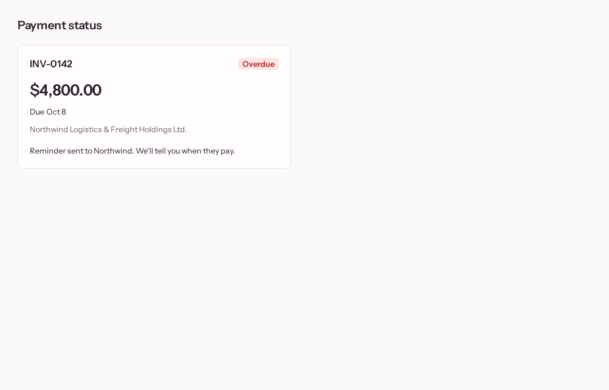
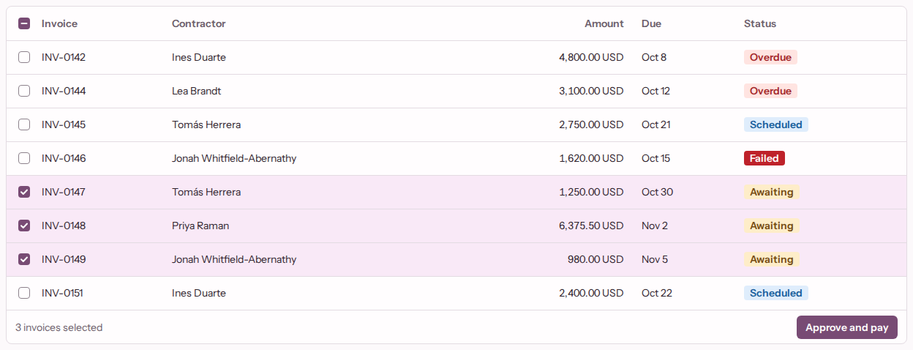

# design-demo

An AI-built design system, and the guardrails that keep AI-generated screens on it. Built in public.

I've spent 15 years making designers' work ship at award level. This repo encodes that craft as a system: a one-page design brief I wrote, a component library Claude Code builds against it, and the gates and evals that keep AI output production-ready.

**[Case study](docs/case-study.md)** · **[Storybook](https://gianko.github.io/design-demo/)** · **[Eval report](https://gianko.github.io/design-demo/evals/)** · **[Figma file](https://www.figma.com/design/qgCHZ55XTiozWpZvASRzJE/Dill-Demo)** · **[Design brief](docs/design-brief.md)** · **[Where it stands](#where-it-stands)**

| A generated screen, kept and gated | A library component at admin density |
|---|---|
|  |  |

## What it is

The domain is contractor payroll and invoicing: an admin who clears dozens of invoices a day, and a contractor who checks on their money a few times a month.

1. **A human-written design brief** is the source of taste: [`docs/design-brief.md`](docs/design-brief.md). It sets tone, density by audience, type, colour roles, spacing, radius, elevation and motion, and bans the generic AI defaults (no Inter, no Tailwind palette, no pills, no bounce easing).
2. **Claude Code builds the design system against it.** DTCG tokens become CSS variables, TypeScript types and Figma variables. Each component is built by one headless `/build-component` session that has to pass every gate. A human approves its baselines, and triages what the session wrote up as gaps.
3. **A generator turns a plain-language screen brief into a screen** in two steps: a typed UI spec (Zod-validated JSON that can only name registered components and props), then real React/TSX from that spec. It uses only library components and tokens, never raw elements or values.
4. **Motion comes from the library, not the model.** The UI spec has no motion vocabulary: every screen-state change is a View Transition the library owns, so a confirmed action settles and a failed one doesn't, whatever the model wrote.
5. **Gates pass or fail the output**, and each step repairs itself from the failures, up to 3 attempts.
6. **An eval suite** runs a fixed set of screen briefs K times and reports pass rates, attempts and cost, compared across prompt and registry versions.
7. **Figma is an output.** Tokens sync into Figma variables with light/dark and admin/contractor modes, and screens are captured as layers bound to those variables, through Figma's official MCP server. Code is the source of truth.

## Where it stands

✅ shipped · 🚧 in progress · ○ planned

| Part | | |
|---|---|---|
| Design brief | ✅ | |
| Tokens → CSS, TypeScript and Figma variables | ✅ | |
| Component library in Storybook | ✅ | 15 components |
| Two-step generator with repair | ✅ | |
| Gates 1–4, 6 and 8 | ✅ | [The gates](#the-gates) |
| Taste lint (gate 7) | ✅ | All 16 rules |
| Eval runner and report | ✅ | [Latest run](#results-latest-eval-run) |
| Eval set | ✅ | 15 screen briefs, for admins and contractors |
| Comparison across prompt versions | ✅ | The report compares each run against the baseline it names |
| Figma: variables with modes, screen captures | ✅ | |
| Motion: screen-state View Transitions | ✅ | |
| Motion: Toast, Sheet, table-action-to-toast, row-to-sheet | ✅ | [ADR 0011](docs/adr/0011-motion-follows-declared-state-changes-owned-by-the-library.md), [ADR 0013](docs/adr/0013-bulk-actions-live-in-datatables-footer-results-are-toasts.md) |
| Brief conformance (gate 5) | ✅ | Hard, in `pnpm generate` and `pnpm evals`, since its [calibration](evals/calibration/report.md) got 144 of 144 verdicts right with none flipping; it sends no repair turn ([ADR 0014](docs/adr/0014-brief-conformance-is-a-soft-vision-judge-proved-by-a-calibration-set.md)) |
| Figma: component frames | 🚧 | Generated by `pnpm figma:sync-components`; the first apply to the file is next ([ADR 0015](docs/adr/0015-component-frames-are-generated-from-each-components-tv-config.md)) |
| Case study | 🚧 | [Draft](docs/case-study.md), including what a designer should change |

## Building in public

Every change lands as a pull request, every eval run's results file is committed, and the [eval report](https://gianko.github.io/design-demo/evals/) is redeployed from `main`. The record of how the system gets better is the comparison between runs, not a claim in this README.

**Latest:** the P2 eval run with gate 5 on, [below](#results-latest-eval-run), and gate 5's [calibration](evals/calibration/report.md).
**Next:** an eval run with gate 5 hard, compared against the P2 run, where it was soft; the first apply of the component frames to the Figma file; and the case study.

## Results: latest eval run

<!-- eval-table:start: written by `pnpm evals:readme` from the newest results file -->

15 screen briefs, K = 3, Opus 5.5, on a clean tree at `25e2624` ([results file](evals/results/2026-10-29-p2.json)). The [report](https://gianko.github.io/design-demo/evals/) compares it against [2026-10-28-p1](evals/results/2026-10-28-p1.json). Gate 5 was soft in this run, and 2026-10-28-p1 ran without it, so neither's passes count brief conformance.

| Screen brief | Audience | Passed | First attempt | Cost |
|---|---|---|---|---|
| [annual-summary](evals/briefs/annual-summary.md) | contractor | 3 / 3 | 3 / 3 | $0.48, of which gate 5 $0.13 |
| [bulk-pay](evals/briefs/bulk-pay.md) | admin | 1 / 3 | 1 / 3 | $0.99, of which gate 5 $0.34 |
| [contractors](evals/briefs/contractors.md) | admin | 3 / 3 | 3 / 3 | $0.68, of which gate 5 $0.19 |
| [failed-payments](evals/briefs/failed-payments.md) | admin | 1 / 3 | 0 / 3 | $1.25, of which gate 5 $0.43 |
| [invoice-queue](evals/briefs/invoice-queue.md) | admin | 3 / 3 | 3 / 3 | $1.05, of which gate 5 $0.39 |
| [invoice-review](evals/briefs/invoice-review.md) | admin | 3 / 3 | 3 / 3 | $0.90, of which gate 5 $0.23 |
| [my-invoices](evals/briefs/my-invoices.md) | contractor | 3 / 3 | 3 / 3 | $0.63, of which gate 5 $0.24 |
| [overdue-invoices](evals/briefs/overdue-invoices.md) | admin | 3 / 3 | 3 / 3 | $1.13, of which gate 5 $0.54 |
| [payment-failed](evals/briefs/payment-failed.md) | contractor | 3 / 3 | 3 / 3 | $0.74, of which gate 5 $0.25 |
| [payment-overview](evals/briefs/payment-overview.md) | contractor | 3 / 3 | 3 / 3 | $0.49, of which gate 5 $0.16 |
| [payment-run](evals/briefs/payment-run.md) | admin | 3 / 3 | 3 / 3 | $0.59, of which gate 5 $0.17 |
| [payment-status](evals/briefs/payment-status.md) | contractor | 3 / 3 | 3 / 3 | $1.03, of which gate 5 $0.30 |
| [payments-received](evals/briefs/payments-received.md) | contractor | 3 / 3 | 3 / 3 | $0.54, of which gate 5 $0.22 |
| [run-history](evals/briefs/run-history.md) | admin | 3 / 3 | 3 / 3 | $0.62, of which gate 5 $0.24 |
| [withdraw-invoice](evals/briefs/withdraw-invoice.md) | contractor | 3 / 3 | 3 / 3 | $0.87, of which gate 5 $0.22 |
| **All** | | **41 / 45** | **40 / 45** | **$11.99, of which gate 5 $4.03** |

<!-- eval-table:end -->

The table is written from the newest results file. After committing an eval run, run `pnpm evals:readme` to rewrite it; a test fails while it's stale.

## The gates

Gates run on generated screens and on the design system itself, so the library is held to the standard it enforces. `pnpm gate` renders every story in one pinned Playwright image, light and dark × admin and contractor, locally and in CI.

| Gate | Checks | |
|---|---|---|
| 1 | UI spec: schema, registered components and props only, valid bindings, states and actions | ✅ |
| 2 | ESLint: no raw colour, spacing, radius or font values; library imports only; screen state only through the library | ✅ |
| 3 | TypeScript and build | ✅ |
| 4 | Accessibility: axe-core, serious or critical fails | ✅ |
| 5 | Brief conformance: Opus 5.5 judges each screen state's screenshot against six criteria from the design brief; hard since its [calibration](evals/calibration/report.md), but it sends no repair turn ([ADR 0014](docs/adr/0014-brief-conformance-is-a-soft-vision-judge-proved-by-a-calibration-set.md)) | ✅ `pnpm generate`, `pnpm evals` |
| 6 | Visual regression: zero differing pixels against committed baselines | ✅ |
| 7 | Taste lint: our own rules, static and rendered ([`RULES.md`](lint/taste/RULES.md)) | ✅ |
| 8 | Style expectations: a story's own assertions on computed style | ✅ |

The taste rules are a triage of [impeccable](https://github.com/pbakaus/impeccable)'s 61 detector rules (kept, adapted or skipped, each with a reason), plus rules the brief demands that impeccable doesn't have, such as tabular figures on money and motion only through tokens. No code is copied.

## What's human, what's AI

- **Human:** the design brief, the architecture and every decision in [`docs/adr/`](docs/adr/), the screen briefs, and the triage of each component's gaps (accepted gaps are recorded in [`.out-of-scope/`](.out-of-scope/)).
- **AI:** the components, their stories and baselines, every generated screen, and most of the code, written by Claude Code against the brief and the ADRs.
- **Open for review:** the visual decisions follow from the brief through AI build sessions. They're the first thing a designer on the team should review before anything here ships.

## Decisions

Each one is an ADR in [`docs/adr/`](docs/adr/):

1. [Density follows the audience](docs/adr/0001-density-by-audience.md)
2. [Token-only Tailwind, enforced by ESLint](docs/adr/0002-token-only-tailwind-and-eslint-token-lint.md)
3. [The generator is two Messages API calls, not an agent loop](docs/adr/0003-generator-on-messages-api-not-an-agent-loop.md)
4. [A flat, library-only UI spec and a Zod-first registry](docs/adr/0004-flat-library-only-ui-spec-and-zod-first-registry.md)
5. [DTCG tokens, hand-built into CSS, TS and Figma](docs/adr/0005-dtcg-tokens-hand-built-into-css-ts-and-figma.md)
6. [One gated build session per component](docs/adr/0006-one-gated-build-component-session-per-component.md)
7. [Figma sync is a generated one-call script](docs/adr/0007-figma-sync-is-a-generated-one-call-script.md)
8. [Eval runs are a budgeted script, compared after the fact](docs/adr/0008-eval-runs-are-a-budgeted-script-compared-after-the-fact.md)
9. [Gates render in one pinned linux/arm64 image](docs/adr/0009-gates-render-in-one-pinned-linux-arm64-image.md)
10. [Each generator step repairs itself from normalised gate failures](docs/adr/0010-each-generator-step-repairs-itself-from-normalised-gate-failures.md)
11. [Motion follows declared state changes, owned by the library](docs/adr/0011-motion-follows-declared-state-changes-owned-by-the-library.md)
12. [Style expectations are read-only play functions, run by gate 8](docs/adr/0012-style-expectations-are-read-only-play-functions-run-by-gate-8.md)
13. [Bulk actions live in DataTable's footer; results are toasts](docs/adr/0013-bulk-actions-live-in-datatables-footer-results-are-toasts.md)
14. [Brief conformance is a hard vision judge, proved by a calibration set](docs/adr/0014-brief-conformance-is-a-soft-vision-judge-proved-by-a-calibration-set.md)
15. [Component frames are generated from each component's `tv()` config](docs/adr/0015-component-frames-are-generated-from-each-components-tv-config.md)

## Run it

Node 22.12+ and pnpm. The gates render in Docker, so it needs to be running.

```sh
pnpm install
pnpm storybook                         # the library
pnpm gate                              # every gate over every story and kept screen
pnpm test                              # unit tests
pnpm evals                             # the eval suite; reads ANTHROPIC_API_KEY from .env, prints a cost estimate first; --estimate stops there
pnpm evals:report --latest             # the HTML report for the newest run, against the baseline it names (pnpm evals --baseline)
pnpm evals:readme                      # rewrite this README's eval table from the newest results file, after committing a run
pnpm evals:calibrate                   # gate 5's calibration set, judged 3 times, into evals/calibration/report.md; prints a cost estimate first; --estimate stops there
pnpm figma:sync-tokens                 # the Figma variables and styles, as a script for use_figma in figma/out/; --dry-run, --prune <id,…>, --split
pnpm figma:sync-components             # the component frames, from each tv() config, run after sync-tokens; --dry-run, --prune <id,…>, --split
```

[`docs/spec.md`](docs/spec.md) has the full build plan, and [`GLOSSARY.md`](GLOSSARY.md) has the vocabulary.
