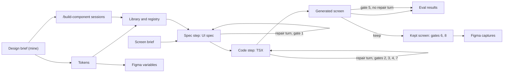

# Case study: an AI-built design system, held to a design brief I wrote

I've spent 15 years making designers' work ship at award level. For this project, I wanted to see if I could bring that same craft to AI-generated interfaces. I wrote a one-page [design brief](design-brief.md), had Claude Code build a design system against it, and put gates and evals in place to check the results. The goal was production-ready screens that follow the design brief, not whatever the model thinks looks good.

Everything here links back to the code, decisions or results.

<!-- tailored:start · these lines change per application; nothing else on the page does -->

## 1. The ask

Deel's [Senior Design Engineer](https://www.deel.com/careers/job/adaa0161-cd93-47d0-aaf3-bd6eabc61a6c/) posting, in Product Design, puts it this way:

> Most teams use AI as a faster way for humans to build products. At Deel, we want to go further: build the system that lets AI build the products, with humans defining the taste, the guardrails, and the standards it works within.

I built this around contractor payroll and invoicing. Deel is "the all-in-one payroll and HR platform for global teams", and I'm a contractor myself, so it's a domain I know firsthand.

<!-- tailored:end -->

## 2. The design brief I wrote, and what Claude built

I wrote the [design brief](design-brief.md) before building a single component. Warm, assured, plain-spoken. [Two densities](adr/0001-density-by-audience.md): compact for admins clearing dozens of invoices a day, more room for contractors checking in a few times a month. Instrument Sans for everything. One heather accent over plum-tinted neutrals. Motion as the signature. No generic AI design defaults.

Then I had Claude Code build against it:

- **Tokens** in CSS, TypeScript and Figma variables ([ADR 0005](adr/0005-dtcg-tokens-hand-built-into-css-ts-and-figma.md)).
- **[Fifteen components](../src/components/)**, each built in its own headless `/build-component` session. Every session had to pass every gate ([ADR 0006](adr/0006-one-gated-build-component-session-per-component.md)). Claude opened 74 gap issues for decisions the design brief didn't cover. I went through every one ([`.out-of-scope/`](../.out-of-scope/)).
- **A generator** with two model calls. A screen brief becomes a Zod-validated UI spec that can only reference registered components. The second call turns that into React/TSX ([ADR 0003](adr/0003-generator-on-messages-api-not-an-agent-loop.md), [ADR 0004](adr/0004-flat-library-only-ui-spec-and-zod-first-registry.md)).
- **[Sixteen taste rules](../lint/taste/RULES.md)** and **[fifteen screen briefs](../evals/briefs/)**.

## 3. The pipeline

I kept the repair loop simple. Each step can fix its own failures, with up to 3 attempts. Nothing gets sent back through the whole pipeline ([ADR 0010](adr/0010-each-generator-step-repairs-itself-from-normalised-gate-failures.md)).

## 4. The gates, and what they caught

The gates catch problems before a generated screen gets kept. These are actual failures from committed runs, not hypothetical examples.

| Gate | A real failure, from committed results |
|---|---|
| 1, UI spec | payment-status rep 3, [rerun](../evals/results/2026-10-26-rerun.json): `slot-exists · page-header · It names no slot; Stack's slots are body.` Fixed on attempt 2. |
| 3, TypeScript | invoice-review, all 3 reps of the [first run](../evals/results/2026-10-26-eval.json), attempt 1: `TS18047 · 'data.reviewInvoice' is possibly 'null'.` |
| 5, brief conformance | run-history rep 3, [P2 hard run](../evals/results/2026-10-31-p2-hard.json), sheet open: `repetition`, the sheet row reads "Contractors paid" beside "5 contractors". |
| 7, taste lint | failed-payments, all 3 reps of the [P1 run](../evals/results/2026-10-28-p1.json), attempt 1: `text-overflow`, a failure reason "spills out of its box" into the status column. |
| Pass criteria | bulk-pay rep 3, [P1 run](../evals/results/2026-10-28-p1.json): every gate passed, but the UI spec missed `table-action-to-toast`. The only fail of 45. |

Every gate 1, 3 and 7 failure above was fixed in one repair turn.

The TypeScript failure also exposed a problem with my generator. The code step didn't know a binding could be nullable. I fixed that in [#199](https://github.com/gianko/design-demo/pull/199) by giving it the fixture types.

Repair has limits, though. In the [P2 run](../evals/results/2026-10-29-p2.json), failed-payments' `text-overflow` survived all 3 code attempts in reps 1 and 3. And gate 5 sends no repair turn, so a gate 5 fail stands.

Gates 2, 4, 6 and 8 haven't failed a rep in a committed run. Gate 2 is mostly handled by how the system is built: generated TSX can't use raw elements, `className` or `style` ([ADR 0011](adr/0011-motion-follows-declared-state-changes-owned-by-the-library.md)).

Gates 6 and 8 check the library and kept screens instead of fresh generations. A new screen doesn't have a baseline to compare against ([ADR 0009](adr/0009-gates-render-in-one-pinned-linux-arm64-image.md)).

## 5. Evals: P0 to P2

I ran the generator against the screen briefs and compared the results. Here's how it progressed.

| Run | Screen briefs | Passed | First attempt | Cost |
|---|---|---|---|---|
| [2026-10-26-eval](../evals/results/2026-10-26-eval.json), P0 | 5 | 15 / 15 | 10 / 15 | $3.98 |
| [2026-10-26-rerun](../evals/results/2026-10-26-rerun.json), after #199 | 5 | 15 / 15 | 14 / 15 | $3.98 |
| [2026-10-28-p1](../evals/results/2026-10-28-p1.json) | 15 | 44 / 45 | 41 / 45 | $10.22 |
| [2026-10-29-p2](../evals/results/2026-10-29-p2.json), gate 5 soft | 15 | 41 / 45 | 40 / 45 | $11.99, of which gate 5 $4.03 |
| [2026-10-31-p2-hard](../evals/results/2026-10-31-p2-hard.json), gate 5 hard | 15 | 42 / 45 | 38 / 45 | $11.03, of which gate 5 $3.67 |

All runs used K = 3, Opus 5.5 and a clean tree. The [eval report](https://gianko.github.io/design-demo/evals/) has the comparisons ([ADR 0008](adr/0008-eval-runs-are-a-budgeted-script-compared-after-the-fact.md)).

For the five screen briefs shared by P0 and P1, first-attempt passes improved from 14 / 15 to 15 / 15. Cost dropped from $3.98 to $3.56 ([#312](https://github.com/gianko/design-demo/pull/312)). One caveat: [ADR 0013](adr/0013-bulk-actions-live-in-datatables-footer-results-are-toasts.md) changed invoice-queue between those runs.

At 44 of 45, I was running into a different problem. The existing gates were passing almost everything, but none of them checked whether a screen actually looked like the design brief.

That's why I added gate 5, brief conformance. Opus 5.5 judges each screen state's screenshot against six criteria taken from the design brief. I kept it soft until a calibration set showed the verdicts were reliable. It's hard now ([ADR 0014](adr/0014-brief-conformance-is-a-soft-vision-judge-proved-by-a-calibration-set.md)).

- **Calibration** ([report](../evals/calibration/report.md)). Kept screens, plus copies broken on one criterion each, every one judged 3 times. The first run got 112 of 117 verdicts right, with 1 of 48 flips. Accent was weak at 75% ([#319](https://github.com/gianko/design-demo/issues/319)). That 96% also left out 27 of the 144 verdicts, which weren't run because their reasons misquoted the design brief ([#341](https://github.com/gianko/design-demo/issues/341)). Once I fixed the misquotes, it got 141 of 144 with none flipping, and I made gate 5 hard ([#347](https://github.com/gianko/design-demo/issues/347)). The latest run is 180 of 180, with 0 of 60 flips, over 10 screens, for $2.81.
- **Gate 5, P2 eval run, soft.** It judged only 27 of 45 reps. In the rest, reasons that misquoted the design brief dropped whole screen states' verdicts ([#341](https://github.com/gianko/design-demo/issues/341)). Among those 27: density, elevation and copy 27 / 27; hierarchy and accent 24 / 27; repetition 23 / 27.
- **Gate 5, P2 eval run, hard.** It judged all 45 reps. Hierarchy, density, accent and elevation went 45 / 45; copy 42 / 42, with 3 undecided; repetition 42 / 45. Those 3 repetition fails are the run's only fails, and two of them were the judge's fault. On payment-run reps 2 and 3, it flipped on an identical screen: the screen brief requires an Overdue card with its Overdue tag, so the screen couldn't avoid saying Overdue twice ([#354](https://github.com/gianko/design-demo/issues/354)). The judge prompt now counts a tag the brief asks for as the brief's copy, and payment-run joined the calibration set to measure the fix. No eval run has measured it yet, so the table still says 42 / 45.

## 6. Motion

I kept motion out of the generated code. The UI spec has no motion vocabulary, and the code step doesn't write animations.

Instead, the library handles motion through View Transitions, based on the screen-state changes declared in the UI spec. A confirmed action settles. A failed one doesn't, whatever the model wrote. That decision lives in the library, not with the model generating the screen ([ADR 0011](adr/0011-motion-follows-declared-state-changes-owned-by-the-library.md)).

The two signature transitions:

1. **Pay:** the Button gets a progress edge while pending. Once confirmed, only the changed statuses flip, 40ms apart. Then a toast slides in with a small overshoot ([#208](https://github.com/gianko/design-demo/issues/208), [#299](https://github.com/gianko/design-demo/issues/299)).
2. **The invoice-detail sheet** slides in from the edge ([#292](https://github.com/gianko/design-demo/issues/292)).

I also made motion testable. The `action-transitions` taste rule clicks every declared action and checks that its result uses a View Transition. `motion-reduced` checks that reduced motion uses a `fast` crossfade.

## 7. Figma

I kept code as the source of truth. Figma is where I'd hand things over to a designer for feedback.

`figma:sync-tokens` generates a script that runs in one atomic, checksummed `use_figma` call ([ADR 0007](adr/0007-figma-sync-is-a-generated-one-call-script.md)). The [Figma file](https://www.figma.com/design/qgCHZ55XTiozWpZvASRzJE/Dill-Demo) gets Color variables in Light and Dark modes, and Density variables in Admin and Contractor.

I captured the three kept screens in both themes, then walked through the captures to check which variables actually bound ([#69](https://github.com/gianko/design-demo/issues/69), [#211](https://github.com/gianko/design-demo/issues/211), [#217](https://github.com/gianko/design-demo/issues/217)).

That caught a small but annoying mismatch. Figma binds captured colours by value. One blue was an 8-bit step away from what Chrome painted, so Figma left it unbound. I changed the output so every colour uses the same 8-bit `rgb()` value Figma receives ([#285](https://github.com/gianko/design-demo/issues/285)).

The components are in Figma too. `figma:sync-components` generates the file's Components page from each component's `tv()` config ([ADR 0015](adr/0015-component-frames-are-generated-from-each-components-tv-config.md)). The first apply ([#323](https://github.com/gianko/design-demo/issues/323)) replaced the hand-built Button set from [#15](https://github.com/gianko/design-demo/issues/15) with 14 generated sets, 45 variants in all. A dry run after it reports nothing to change.

Every fill, stroke and glyph binds to a variable. Flip Light to Dark and Button's fill goes `#784b74` to `#dbb7d7`. Flip Admin to Contractor and Button grows from 32 to 44 high, and Card's radius from 8 to 12 ([#286](https://github.com/gianko/design-demo/issues/286)). The sets together make a script over `use_figma`'s 50,000-character limit, so `--split` applies one script per set, and a failure partway can't roll back the sets before it ([#323](https://github.com/gianko/design-demo/issues/323)).

A designer will notice one thing: Toast's and Sheet's close buttons are empty frames, because ADR 0015 rules out nested instances.

## 8. Decisions I reversed

Some ideas looked right on paper but didn't hold up once I saw them on a real screen. I changed them.

- **ActionBar.** In [ADR 0011](adr/0011-motion-follows-declared-state-changes-owned-by-the-library.md), bulk actions lived in a raised bar that transformed into a success toast. On the kept bulk-pay screen, it looked like a slab floating away from the table. Worse, it kept popping in and out as selection changed. I cut it. [ADR 0013](adr/0013-bulk-actions-live-in-datatables-footer-results-are-toasts.md) moved the actions into DataTable's footer and made the result a corner toast ([#298](https://github.com/gianko/design-demo/issues/298)). That came with tradeoffs. Four screen briefs' runs are no longer comparable across the change, and the success toast dismisses itself, which bends the design brief's "motion only when the user acts".
- **The row expanding into the sheet.** I originally specified this morph as one of the design brief's signature transitions. Then I replaced it with a sheet that slides in from the edge ([#292](https://github.com/gianko/design-demo/issues/292)). I updated the design brief in the same PR ([#302](https://github.com/gianko/design-demo/pull/302)). No baselines changed.

## 9. What a designer should change

I made these decisions myself, but they're also [the first ones I'd hand to a designer](design-brief.md#calls-id-hand-to-a-designer) for a second opinion.

- **The heather accent.** Is one accent enough to make the primary action stand out in a busy admin table?
- **Instrument Sans alone**, with no display face. Does it give us enough hierarchy and warmth?
- **Two densities instead of one** ([ADR 0001](adr/0001-density-by-audience.md)). Is the difference worth the extra work across every component?
- **The plum tint on every neutral.** Does it actually feel warm, or just slightly off?

Honestly, I'm not sure of any of the four. I made each call alone, against my own design brief, with no designer to push back. That's why they're first on the list: I'd want a designer's eye on all of them before anything here ships.

## 10. Next

- **Generative UI in the product.** I deliberately left this out of scope. The registry and gates are there to keep runtime-generated screens within the system.
- **Forms.** I cut Input and Select from P1 ([After P1](spec.md#after-p1)).
