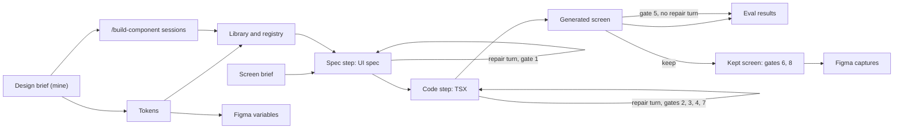

# Case study: an AI-built design system, held to a design brief I wrote

I've spent 15 years making designers' work ship at award level. This repo is that craft built as a system: a one-page [design brief](design-brief.md) I wrote, a design system Claude Code built against it, and the gates and evals that keep generated screens production-ready. Every claim links to its evidence.

> **Draft.** Claude wrote this from the ADRs, the results files and the history, and filled in the final numbers. [#325](https://github.com/gianko/design-demo/issues/325) rewrites it in my voice and fills the one place still marked **#325 fills this**.

<!-- tailored:start · these lines change per application; nothing else on the page does -->

## 1. The ask

Deel's [Senior Design Engineer](https://www.deel.com/careers/job/adaa0161-cd93-47d0-aaf3-bd6eabc61a6c/) posting, in Product Design, puts it this way:

> Most teams use AI as a faster way for humans to build products. At Deel, we want to go further: build the system that lets AI build the products, with humans defining the taste, the guardrails, and the standards it works within.

The screens here are contractor payroll and invoicing. Deel is "the all-in-one payroll and HR platform for global teams", and I'm a contractor myself, so it's a domain I live.

<!-- tailored:end -->

## 2. The design brief I wrote, and what Claude built

The [design brief](design-brief.md) came before any component: warm, assured, plain-spoken; [density by audience](adr/0001-density-by-audience.md), dense for the admin who clears dozens of invoices a day, roomy for the contractor who checks in a few times a month; Instrument Sans alone; one heather accent over plum-tinted neutrals; motion as the signature; and the generic AI defaults banned.

Claude Code built against it:

- **Tokens**, built into CSS, TypeScript and Figma variables ([ADR 0005](adr/0005-dtcg-tokens-hand-built-into-css-ts-and-figma.md)).
- **[Fifteen components](../src/components/)**, each by one headless `/build-component` session that had to pass every gate ([ADR 0006](adr/0006-one-gated-build-component-session-per-component.md)). The sessions wrote up 74 gap issues where the design brief didn't decide; I triaged each one ([`.out-of-scope/`](../.out-of-scope/)).
- **A generator** of two model calls: a screen brief becomes a Zod-validated UI spec naming only registered components, then React/TSX ([ADR 0003](adr/0003-generator-on-messages-api-not-an-agent-loop.md), [ADR 0004](adr/0004-flat-library-only-ui-spec-and-zod-first-registry.md)).
- **[Sixteen taste rules](../lint/taste/RULES.md)** and **[fifteen screen briefs](../evals/briefs/)**.

## 3. The pipeline

Each step repairs only itself, up to 3 attempts ([ADR 0010](adr/0010-each-generator-step-repairs-itself-from-normalised-gate-failures.md)).

## 4. The gates, and what they caught

| Gate | A real failure, from committed results |
|---|---|
| 1, UI spec | payment-status rep 3, [rerun](../evals/results/2026-10-26-rerun.json): `slot-exists · page-header · It names no slot; Stack's slots are body.` Fixed on attempt 2. |
| 3, TypeScript | invoice-review, all 3 reps of the [first run](../evals/results/2026-10-26-eval.json), attempt 1: `TS18047 · 'data.reviewInvoice' is possibly 'null'.` |
| 5, brief conformance | run-history rep 3, [P2 hard run](../evals/results/2026-10-31-p2-hard.json), sheet open: `repetition`, the sheet row reads "Contractors paid" beside "5 contractors". |
| 7, taste lint | failed-payments, all 3 reps of the [P1 run](../evals/results/2026-10-28-p1.json), attempt 1: `text-overflow`, a failure reason "spills out of its box" into the status column. |
| Pass criteria | bulk-pay rep 3, [P1 run](../evals/results/2026-10-28-p1.json): it passed every gate, but its UI spec missed `table-action-to-toast`. The only fail of 45. |

One repair turn fixed every gate 1, 3 and 7 failure above. The gate 3 one also changed the generator: the code step couldn't see that a binding was nullable, so [#199](https://github.com/gianko/design-demo/pull/199) gave it the fixture types. Repair has limits, though: in the [P2 run](../evals/results/2026-10-29-p2.json), failed-payments' `text-overflow` survived all 3 code attempts in reps 1 and 3. Gate 5 sends no repair turn, so a gate 5 fail stands.

Gates 2, 4, 6 and 8 haven't failed a rep in a committed run. Gate 2 is mostly met by construction: generated TSX can't use raw elements, `className` or `style` ([ADR 0011](adr/0011-motion-follows-declared-state-changes-owned-by-the-library.md)). Gates 6 and 8 hold the library and kept screens, since a fresh screen has no baseline ([ADR 0009](adr/0009-gates-render-in-one-pinned-linux-arm64-image.md)).

## 5. Evals: P0 to P2

| Run | Screen briefs | Passed | First attempt | Cost |
|---|---|---|---|---|
| [2026-10-26-eval](../evals/results/2026-10-26-eval.json), P0 | 5 | 15 / 15 | 10 / 15 | $3.98 |
| [2026-10-26-rerun](../evals/results/2026-10-26-rerun.json), after #199 | 5 | 15 / 15 | 14 / 15 | $3.98 |
| [2026-10-28-p1](../evals/results/2026-10-28-p1.json) | 15 | 44 / 45 | 41 / 45 | $10.22 |
| [2026-10-29-p2](../evals/results/2026-10-29-p2.json), gate 5 soft | 15 | 41 / 45 | 40 / 45 | $11.99, of which gate 5 $4.03 |
| [2026-10-31-p2-hard](../evals/results/2026-10-31-p2-hard.json), gate 5 hard | 15 | 42 / 45 | 38 / 45 | $11.03, of which gate 5 $3.67 |

K = 3, Opus 5.5, clean tree, compared in the [eval report](https://gianko.github.io/design-demo/evals/) ([ADR 0008](adr/0008-eval-runs-are-a-budgeted-script-compared-after-the-fact.md)). On the five screen briefs that P0 and P1 share, first attempts went from 14 / 15 to 15 / 15 and cost from $3.98 to $3.56 ([#312](https://github.com/gianko/design-demo/pull/312)), though [ADR 0013](adr/0013-bulk-actions-live-in-datatables-footer-results-are-toasts.md) changed invoice-queue in between.

At 44 of 45, the gates no longer told runs apart, and none asked whether a screen looks like the design brief. That's gate 5, brief conformance: Opus 5.5 judging each screen state's screenshot on six criteria from the design brief. It stayed soft until a calibration set showed its verdicts could be trusted, and it's hard now ([ADR 0014](adr/0014-brief-conformance-is-a-soft-vision-judge-proved-by-a-calibration-set.md)).

- **Calibration** ([report](../evals/calibration/report.md)): kept screens and copies broken on one criterion each, every one judged 3 times. The first run got 112 of 117 verdicts right, with 1 of 48 flips, and accent was weak at 75% ([#319](https://github.com/gianko/design-demo/issues/319)). That 96% left out 27 of the 144 verdicts, which weren't run because their reasons misquoted the design brief ([#341](https://github.com/gianko/design-demo/issues/341)). Once the misquotes were fixed it got 141 of 144 with none flipping, and gate 5 went hard ([#347](https://github.com/gianko/design-demo/issues/347)). The latest run is 180 of 180, with 0 of 60 flips, over 10 screens, for $2.81.
- **Gate 5, P2 eval run, soft:** it judged only 27 of 45 reps, because in the rest, reasons that misquoted the design brief dropped whole screen states' verdicts ([#341](https://github.com/gianko/design-demo/issues/341)). Among those 27: density, elevation and copy 27 / 27; hierarchy and accent 24 / 27; repetition 23 / 27.
- **Gate 5, P2 eval run, hard:** it judged all 45 reps. Hierarchy, density, accent and elevation went 45 / 45; copy 42 / 42, with 3 undecided; repetition 42 / 45. Those 3 repetition fails are the run's only fails. Two of them, payment-run reps 2 and 3, were the judge flipping on an identical screen: the screen brief requires an Overdue card with its Overdue tag, so the screen couldn't avoid saying Overdue twice ([#354](https://github.com/gianko/design-demo/issues/354)). The judge prompt now counts a tag the brief asks for as the brief's copy, and payment-run joined the calibration set to measure the fix. No eval run has measured it yet, so the table still says 42 / 45.

## 6. Motion

The UI spec has no motion vocabulary and the code step writes none. The library animates the screen-state changes a UI spec declares, as View Transitions, so a confirmed action settles and a failed one doesn't, whatever the model wrote ([ADR 0011](adr/0011-motion-follows-declared-state-changes-owned-by-the-library.md)). The two signature transitions:

1. **Pay:** the Button's progress edge while pending, then only the changed statuses flip, 40ms apart, and a toast slides in with one small overshoot ([#208](https://github.com/gianko/design-demo/issues/208), [#299](https://github.com/gianko/design-demo/issues/299)).
2. **The invoice-detail sheet** slides in from the edge ([#292](https://github.com/gianko/design-demo/issues/292)).

The taste rule `action-transitions` clicks every declared action and checks its result arrives through a View Transition; `motion-reduced` checks reduced motion is a `fast` crossfade.

## 7. Figma

Code is the source of truth; Figma is where a designer comments. `figma:sync-tokens` is a generated script run in one atomic, checksummed `use_figma` call ([ADR 0007](adr/0007-figma-sync-is-a-generated-one-call-script.md)). It gives the [file](https://www.figma.com/design/qgCHZ55XTiozWpZvASRzJE/Dill-Demo) its variables: Color in Light and Dark modes, Density in Admin and Contractor. The three kept screens are captured in both themes and walked to check what bound ([#69](https://github.com/gianko/design-demo/issues/69), [#211](https://github.com/gianko/design-demo/issues/211), [#217](https://github.com/gianko/design-demo/issues/217)). A capture binds by value, so when Figma read a blue one 8-bit step off Chrome's paint, it stayed unbound; every colour now ships as the 8-bit `rgb()` Figma gets ([#285](https://github.com/gianko/design-demo/issues/285)).

- **Component frames:** `figma:sync-components` generates the file's Components page from each component's `tv()` config ([ADR 0015](adr/0015-component-frames-are-generated-from-each-components-tv-config.md)). The first apply ([#323](https://github.com/gianko/design-demo/issues/323)) replaced the hand-built Button set from [#15](https://github.com/gianko/design-demo/issues/15) with 14 generated sets, 45 variants in all. A dry run after it reports nothing to change. Every fill, stroke and glyph binds to a variable: flip Light to Dark and Button's fill goes `#784b74` to `#dbb7d7`; flip Admin to Contractor and Button grows from 32 to 44 high, Card's radius from 8 to 12 ([#286](https://github.com/gianko/design-demo/issues/286)). The sets together make a script over `use_figma`'s 50,000-character limit, so `--split` applies one script per set, and a failure partway can't roll back the sets before it ([#323](https://github.com/gianko/design-demo/issues/323)). A designer will notice one thing: Toast's and Sheet's close buttons are empty frames, because ADR 0015 rules out nested instances.

## 8. Decisions I reversed

- **ActionBar.** [ADR 0011](adr/0011-motion-follows-declared-state-changes-owned-by-the-library.md) gave a bulk action a raised bar that turned into the success toast. On the kept bulk-pay screen it read as a slab floating apart from its table, and it popped in and out with the selection. [ADR 0013](adr/0013-bulk-actions-live-in-datatables-footer-results-are-toasts.md) moved bulk actions into DataTable's actions footer and made the result a corner toast ([#298](https://github.com/gianko/design-demo/issues/298)). The cost: four screen briefs' runs don't compare across it, and a success toast now leaves on its own, bending the design brief's "motion only when the user acts".
- **The row expanding into the sheet.** That morph was one of the design brief's own signature transitions. [#292](https://github.com/gianko/design-demo/issues/292) made the sheet slide in from the edge instead, and the design brief changed in the same PR ([#302](https://github.com/gianko/design-demo/pull/302)), with no baseline changed.

## 9. What a designer should change

These are my calls, the ones the design brief names as [the first I'd hand to a designer](design-brief.md#calls-id-hand-to-a-designer):

- **The heather accent.** Does one accent carry the primary action on a busy admin table?
- **Instrument Sans alone**, with no display face. Is there enough hierarchy and warmth?
- **Two densities instead of one** ([ADR 0001](adr/0001-density-by-audience.md)). Is the split worth what it costs every component?
- **The plum tint on every neutral.** Does it read as warm, or as off?

**#325 fills this:** I write this section myself.

## 10. Next

- **Generative UI in the product.** Out of scope on purpose here; the registry and gates are what would keep runtime screens on the system.
- **Forms.** Input and Select were cut in P1 ([After P1](spec.md#after-p1)).
