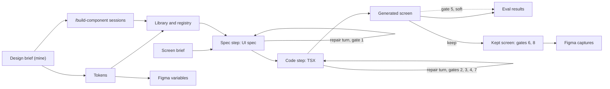

# Case study: an AI-built design system, held to a brief I wrote

I've spent 15 years making designers' work ship at award level. This repo is that craft built as a system: a one-page [design brief](design-brief.md) I wrote, a design system Claude Code built against it, and the gates and evals that keep generated screens production-ready. Every claim links to its evidence.

> **Draft.** Claude wrote this from the ADRs, the results files and the history. [#325](https://github.com/gianko/design-demo/issues/325) rewrites it in my voice and fills each place marked **#325 fills this**.

<!-- tailored:start · these lines change per application; nothing else on the page does -->

## 1. The ask

Deel's [Senior Design Engineer](https://www.deel.com/careers/job/adaa0161-cd93-47d0-aaf3-bd6eabc61a6c/) posting, in Product Design, puts it this way:

> Most teams use AI as a faster way for humans to build products. At Deel, we want to go further: build the system that lets AI build the products, with humans defining the taste, the guardrails, and the standards it works within.

The screens here are contractor payroll and invoicing. Deel is "the all-in-one payroll and HR platform for global teams", and I'm a contractor myself, so it's a domain I live.

<!-- tailored:end -->

## 2. The brief I wrote, and what Claude built

The [design brief](design-brief.md) came before any component: warm, assured, plain-spoken; [density by audience](adr/0001-density-by-audience.md), dense for the admin who clears dozens of invoices a day, roomy for the contractor who checks in a few times a month; Instrument Sans alone; one heather accent over plum-tinted neutrals; motion as the signature; and the generic AI defaults banned.

Claude Code built against it:

- **Tokens**, built into CSS, TypeScript and Figma variables ([ADR 0005](adr/0005-dtcg-tokens-hand-built-into-css-ts-and-figma.md)).
- **[Fifteen components](../src/components/)**, each by one headless `/build-component` session that had to pass every gate ([ADR 0006](adr/0006-one-gated-build-component-session-per-component.md)). The sessions wrote up 74 gap issues where the brief didn't decide; I triaged each one ([`.out-of-scope/`](../.out-of-scope/)).
- **A generator** of two model calls: a screen brief becomes a Zod-validated UI spec naming only registered components, then React/TSX ([ADR 0003](adr/0003-generator-on-messages-api-not-an-agent-loop.md), [ADR 0004](adr/0004-flat-library-only-ui-spec-and-zod-first-registry.md)).
- **[Sixteen taste rules](../lint/taste/RULES.md)** and **[fifteen screen briefs](../evals/briefs/)**.

## 3. The pipeline

Each step repairs only itself, up to 3 attempts ([ADR 0010](adr/0010-each-generator-step-repairs-itself-from-normalised-gate-failures.md)).

## 4. The gates, and what they caught

| Gate | A real failure, from committed results |
|---|---|
| 1, UI spec | payment-status rep 3, [rerun](../evals/results/2026-10-26-rerun.json): `slot-exists · page-header · It names no slot; Stack's slots are body.` Fixed on attempt 2. |
| 3, TypeScript | invoice-review, all 3 reps of the [first run](../evals/results/2026-10-26-eval.json), attempt 1: `TS18047 · 'data.reviewInvoice' is possibly 'null'.` |
| 7, taste lint | failed-payments, all 3 reps of the [P1 run](../evals/results/2026-10-28-p1.json), attempt 1: `text-overflow`, a failure reason "spills out of its box" into the status column. |
| Pass criteria | bulk-pay rep 3, [P1 run](../evals/results/2026-10-28-p1.json): it passed every gate, but its UI spec missed `table-action-to-toast`. The only fail of 45. |

One repair turn fixed every gate failure above. The gate 3 one also changed the generator: the code step couldn't see that a binding was nullable, so [#199](https://github.com/gianko/design-demo/pull/199) gave it the fixture types.

Gates 2, 4, 6 and 8 haven't failed a rep in a committed run. Gate 2 is mostly met by construction: generated TSX can't use raw elements, `className` or `style` ([ADR 0011](adr/0011-motion-follows-declared-state-changes-owned-by-the-library.md)). Gates 6 and 8 hold the library and kept screens, since a fresh screen has no baseline ([ADR 0009](adr/0009-gates-render-in-one-pinned-linux-arm64-image.md)).

## 5. Evals: P0 to P1

| Run | Screen briefs | Passed | First attempt | Cost |
|---|---|---|---|---|
| [2026-10-26-eval](../evals/results/2026-10-26-eval.json), P0 | 5 | 15 / 15 | 10 / 15 | $3.98 |
| [2026-10-26-rerun](../evals/results/2026-10-26-rerun.json), after #199 | 5 | 15 / 15 | 14 / 15 | $3.98 |
| [2026-10-28-p1](../evals/results/2026-10-28-p1.json) | 15 | 44 / 45 | 41 / 45 | $10.22 |

K = 3, Opus 5.5, clean tree, compared in the [eval report](https://gianko.github.io/design-demo/evals/) ([ADR 0008](adr/0008-eval-runs-are-a-budgeted-script-compared-after-the-fact.md)). On the five briefs the last two share, first attempts went from 14 / 15 to 15 / 15 and cost from $3.98 to $3.56 ([#312](https://github.com/gianko/design-demo/pull/312)), though [ADR 0013](adr/0013-bulk-actions-live-in-datatables-footer-results-are-toasts.md) changed invoice-queue in between.

At 44 of 45, the gates no longer tell runs apart, and none asks whether a screen looks like the brief. That's gate 5, brief conformance: Opus 5.5 judging screenshots on six criteria from the brief, soft until a calibration set shows its verdicts can be trusted ([ADR 0014](adr/0014-brief-conformance-is-a-soft-vision-judge-proved-by-a-calibration-set.md)).

- **Gate 5, P2 eval run:** **#325 fills this** with the pass rate per criterion ([#319](https://github.com/gianko/design-demo/issues/319)).
- **Calibration:** **#325 fills this** with right verdicts and flips ([#318](https://github.com/gianko/design-demo/issues/318)).

## 6. Motion

The UI spec has no motion vocabulary and the code step writes none. The library animates the screen-state changes a UI spec declares, as View Transitions, so a confirmed action settles and a failed one doesn't, whatever the model wrote ([ADR 0011](adr/0011-motion-follows-declared-state-changes-owned-by-the-library.md)). The two signature transitions:

1. **Pay:** the Button's progress edge while pending, then only the changed statuses flip, 40ms apart, and a toast slides in with one small overshoot ([#208](https://github.com/gianko/design-demo/issues/208), [#299](https://github.com/gianko/design-demo/issues/299)).
2. **The invoice-detail sheet** slides in from the edge ([#292](https://github.com/gianko/design-demo/issues/292)).

The taste rule `action-transitions` clicks every declared action and checks its result arrives through a View Transition; `motion-reduced` checks reduced motion is a `fast` crossfade.

## 7. Figma

Code is the source of truth; Figma is where a designer comments. `figma:sync-tokens` is a generated script run in one atomic, checksummed `use_figma` call ([ADR 0007](adr/0007-figma-sync-is-a-generated-one-call-script.md)). It gives the [file](https://www.figma.com/design/qgCHZ55XTiozWpZvASRzJE/Dill-Demo) its variables: Color in Light and Dark modes, Density in Admin and Contractor. The three kept screens are captured in both themes and walked to check what bound ([#69](https://github.com/gianko/design-demo/issues/69), [#211](https://github.com/gianko/design-demo/issues/211), [#217](https://github.com/gianko/design-demo/issues/217)). A capture binds by value, so when Figma read a blue one 8-bit step off Chrome's paint, it stayed unbound; every colour now ships as the 8-bit `rgb()` Figma gets ([#285](https://github.com/gianko/design-demo/issues/285)).

- **Component frames:** **#325 fills this** with the Components page `figma:sync-components` generates from each component's `tv()` config ([ADR 0015](adr/0015-component-frames-are-generated-from-each-components-tv-config.md), [#323](https://github.com/gianko/design-demo/issues/323)).

## 8. Decisions I reversed

- **ActionBar.** [ADR 0011](adr/0011-motion-follows-declared-state-changes-owned-by-the-library.md) gave a bulk action a raised bar that turned into the success toast. On the kept bulk-pay screen it read as a slab floating apart from its table, and it popped in and out with the selection. [ADR 0013](adr/0013-bulk-actions-live-in-datatables-footer-results-are-toasts.md) moved bulk actions into DataTable's actions footer and made the result a corner toast ([#298](https://github.com/gianko/design-demo/issues/298)). The cost: four briefs' runs don't compare across it, and a success toast now leaves on its own, bending the brief's "motion only when the user acts".
- **The row expanding into the sheet.** That morph was one of the brief's own signature transitions. [#292](https://github.com/gianko/design-demo/issues/292) made the sheet slide in from the edge instead, and the brief changed in the same PR ([#302](https://github.com/gianko/design-demo/pull/302)), with no baseline changed.

## 9. What a designer should change

These are my calls, the ones the brief names as [the first I'd hand to a designer](design-brief.md#calls-id-hand-to-a-designer):

- **The heather accent.** Does one accent carry the primary action on a busy admin table?
- **Instrument Sans alone**, with no display face. Is there enough hierarchy and warmth?
- **Two densities instead of one** ([ADR 0001](adr/0001-density-by-audience.md)). Is the split worth what it costs every component?
- **The plum tint on every neutral.** Does it read as warm, or as off?

**#325 fills this:** I write this section myself.

## 10. Next

- **Generative UI in the product.** Out of scope on purpose here; the registry and gates are what would keep runtime screens on the system.
- **Forms.** Input and Select were cut in P1 ([After P1](spec.md#after-p1)).
- **Promoting gate 5 to hard,** once the calibration numbers back it ([ADR 0014](adr/0014-brief-conformance-is-a-soft-vision-judge-proved-by-a-calibration-set.md)).
